# Medusa Subscriptions + Authorize.Net Architecture

This version is a code-driven big-picture view of how the project actually works today.

The most important architectural ideas are:

- Medusa is the host platform and source of core commerce primitives.
- Subscription tiers are modeled as Medusa `customer groups` with tier metadata.
- Add-on credit packs are modeled as Medusa `products` with add-on metadata.
- Custom business state lives in three domain modules: `subscription`, `credit`, and `billing`.
- Authorize.Net is used as a direct payment adapter module, not as a Medusa payment provider.
- Medusa workflows orchestrate writes, while subscribers and a scheduled job trigger lifecycle automation.
- Credits are part of the entitlement model, and some credit mutations use row locking to avoid double-spend races.

---

## Big Picture

```mermaid
graph TB
    classDef client fill:#f8fafc,stroke:#64748b,color:#0f172a
    classDef api fill:#e0f2fe,stroke:#0284c7,color:#0c4a6e
    classDef orchestration fill:#ede9fe,stroke:#7c3aed,color:#4c1d95
    classDef domain fill:#dcfce7,stroke:#16a34a,color:#14532d
    classDef core fill:#fef3c7,stroke:#d97706,color:#78350f
    classDef data fill:#e2e8f0,stroke:#475569,color:#0f172a
    classDef external fill:#ffedd5,stroke:#ea580c,color:#7c2d12

    subgraph Clients["Clients and Triggers"]
        STOREFRONT["Storefront / customer app"]:::client
        ADMINUI["Medusa admin extension"]:::client
        ACCEPT["Authorize.Net Accept.js\n(card tokenization)"]:::external
        EVENTS["Medusa domain events\ncustomer.created\norder.placed"]:::client
        JOB["Scheduled job\nsubscription-maintenance"]:::client
    end

    subgraph Surface["HTTP Surface"]
        STOREAPI["Store API routes\nsubscriptions\ncredits\nbilling\naddons\nperson access / saved"]:::api
        ADMINAPI["Admin API routes\nsubscriptions\ncredit balances\nbilling transactions\ne2e helpers"]:::api
    end

    subgraph Runtime["Application Runtime"]
        subgraph Orchestration["Orchestration"]
            WF_CREATE["create-subscription"]:::orchestration
            WF_UPGRADE["upgrade-subscription"]:::orchestration
            WF_DOWNGRADE["downgrade-subscription"]:::orchestration
            WF_CANCEL["cancel-subscription"]:::orchestration
            WF_REACTIVATE["reactivate-subscription"]:::orchestration
            WF_PAYMENT["update-payment-method"]:::orchestration
            WF_CONSUME["consume-credit"]:::orchestration
            WF_GRANT["grant-addon-credits"]:::orchestration
            SUB_CUSTOMER["Subscriber:\ncustomer.created"]:::orchestration
            SUB_ORDER["Subscriber:\norder.placed"]:::orchestration
        end

        subgraph Domain["Custom Domain Modules"]
            SUBS["Subscription module\nstatus, billing period,\npayment profile refs,\nretry + downgrade state"]:::domain
            CREDIT["Credit module\nbalances, person access,\nsaved profiles,\nconcurrency-safe credit mutations"]:::domain
            BILLING["Billing module\nimmutable transaction ledger"]:::domain
            AUTHNET["Authorize.Net module\nCIM profiles + charge / void / refund"]:::domain
        end

        subgraph MedusaCore["Medusa Core Capabilities"]
            CUSTOMER["Customer module"]:::core
            GROUPS["Customer groups\nused as subscription tiers"]:::core
            PRODUCT["Product module\nused for add-on packs"]:::core
            ORDER["Order module"]:::core
            QUERY["Query graph + remote links"]:::core
        end
    end

    subgraph Storage["Persistence"]
        DB1[(subscription)]:::data
        DB2[(credit_balance)]:::data
        DB3[(person_access)]:::data
        DB4[(saved_profile)]:::data
        DB5[(billing_transaction)]:::data
        DB6[(link tables\ncustomer<->subscription\ncustomer<->credit\ncustomer<->billing)]:::data
    end

    GATEWAY["Authorize.Net gateway"]:::external

    STOREFRONT -->|reads / mutates| STOREAPI
    ADMINUI -->|reads / mutates| ADMINAPI
    STOREFRONT -->|tokenizes card| ACCEPT
    ACCEPT -->|opaque_data token| STOREFRONT

    STOREAPI --> WF_CREATE
    STOREAPI --> WF_UPGRADE
    STOREAPI --> WF_DOWNGRADE
    STOREAPI --> WF_CANCEL
    STOREAPI --> WF_REACTIVATE
    STOREAPI --> WF_PAYMENT
    STOREAPI --> WF_CONSUME
    STOREAPI -->|add-on purchase route can call modules directly| AUTHNET
    STOREAPI -->|add-on purchase route can call modules directly| CREDIT
    STOREAPI -->|add-on purchase route can call modules directly| BILLING
    STOREAPI --> QUERY

    ADMINAPI --> WF_CREATE
    ADMINAPI --> WF_UPGRADE
    ADMINAPI --> WF_DOWNGRADE
    ADMINAPI --> QUERY

    EVENTS --> SUB_CUSTOMER
    EVENTS --> SUB_ORDER
    SUB_CUSTOMER --> WF_CREATE
    SUB_ORDER --> WF_GRANT
    JOB --> SUBS
    JOB --> CREDIT
    JOB --> BILLING
    JOB --> AUTHNET
    JOB --> QUERY
    JOB --> GROUPS

    WF_CREATE --> AUTHNET
    WF_CREATE --> SUBS
    WF_CREATE --> CREDIT
    WF_CREATE --> BILLING
    WF_CREATE --> GROUPS
    WF_CREATE --> QUERY

    WF_UPGRADE --> AUTHNET
    WF_UPGRADE --> SUBS
    WF_UPGRADE --> CREDIT
    WF_UPGRADE --> BILLING
    WF_UPGRADE --> GROUPS
    WF_UPGRADE --> QUERY

    WF_DOWNGRADE --> SUBS
    WF_CANCEL --> SUBS
    WF_REACTIVATE --> SUBS
    WF_PAYMENT --> AUTHNET
    WF_PAYMENT --> SUBS
    WF_CONSUME --> CREDIT
    WF_CONSUME --> QUERY
    WF_GRANT --> CREDIT
    WF_GRANT --> BILLING
    WF_GRANT --> ORDER

    SUBS --> DB1
    CREDIT --> DB2
    CREDIT --> DB3
    CREDIT --> DB4
    BILLING --> DB5
    QUERY --> DB6

    QUERY <--> CUSTOMER
    QUERY <--> GROUPS
    QUERY <--> PRODUCT
    QUERY <--> ORDER

    AUTHNET -->|server-to-server API calls| GATEWAY
```

### Read This Diagram As

- The storefront and admin extension both enter through custom Medusa API routes.
- Write-heavy operations usually go through a Medusa workflow.
- Two automations bypass the UI entirely:
  - `customer.created` auto-provisions the free tier.
  - `order.placed` grants add-on credits for qualifying orders.
- Recurring billing, retry logic, credit resets, and scheduled downgrades are handled by the maintenance job.
- Custom modules own the subscription/credit/billing state, but they still rely on Medusa core entities such as customers, groups, orders, and products.

---

## Lifecycle View

```mermaid
graph LR
    classDef state fill:#eff6ff,stroke:#2563eb,color:#1e3a8a
    classDef action fill:#f8fafc,stroke:#64748b,color:#111827
    classDef pay fill:#ffedd5,stroke:#ea580c,color:#7c2d12
    classDef data fill:#dcfce7,stroke:#16a34a,color:#14532d

    A["1. Customer created"]:::action --> B["Auto-assign free tier\nvia customer.created subscriber"]:::action
    B --> C["Create subscription + credit balance\nlink both to customer\nassign tier group"]:::data

    C --> D["2. Customer upgrades or starts paid plan"]:::action
    D --> E["Accept.js creates opaque token"]:::pay
    E --> F["create-subscription / upgrade-subscription workflow"]:::action
    F --> G["Create or reuse Authorize.Net customer profile\ncharge payment profile if needed"]:::pay
    G --> H["Update subscription payment refs\nrecord billing transaction\nreset or initialize credits"]:::data

    H --> I["3. Customer consumes previews / reports"]:::action
    I --> J["consume-credit workflow"]:::action
    J --> K["Check prior access in billing period\nlock balance row\nconsume credit\nrecord person access"]:::data

    H --> L["4. Customer buys add-on report credits"]:::action
    L --> M["Charge existing payment profile"]:::pay
    M --> N["Grant addon credits\nrecord billing transaction\nvoid/refund on compensation path if needed"]:::data

    H --> O["5. Renewal window arrives"]:::action
    O --> P["subscription-maintenance job"]:::action
    P --> Q["Charge renewal or retry payment\nreset monthly credits\napply scheduled downgrade\ncancel after max retries"]:::data

    Q --> R["6. Customer changes lifecycle state"]:::action
    R --> S["cancel / reactivate / schedule downgrade / cancel downgrade"]:::action
```

---

## Architectural Notes

- `customer groups` are the plan catalog and entitlement source. Tier price, slug, and monthly credit limits live in group metadata.
- `products` are reused for add-on credit packs. Metadata marks which products are add-ons and how many credits they grant.
- The `subscription` record stores operational subscription state, including period boundaries, retry state, pending downgrade info, and saved Authorize.Net profile IDs.
- The `credit` module is more than a balance table. It also tracks which people were accessed and which profiles were saved.
- The add-on purchase route is intentionally more direct than the other write paths: it performs payment, credit mutation, and billing recording without wrapping the whole flow in a Medusa workflow.
- The current implementation appears to be outbound-only with Authorize.Net. The app calls Authorize.Net directly; there is no inbound webhook route in this codebase.
- Remote links are important because they connect custom module records back to Medusa `customer` entities without collapsing everything into one module.
